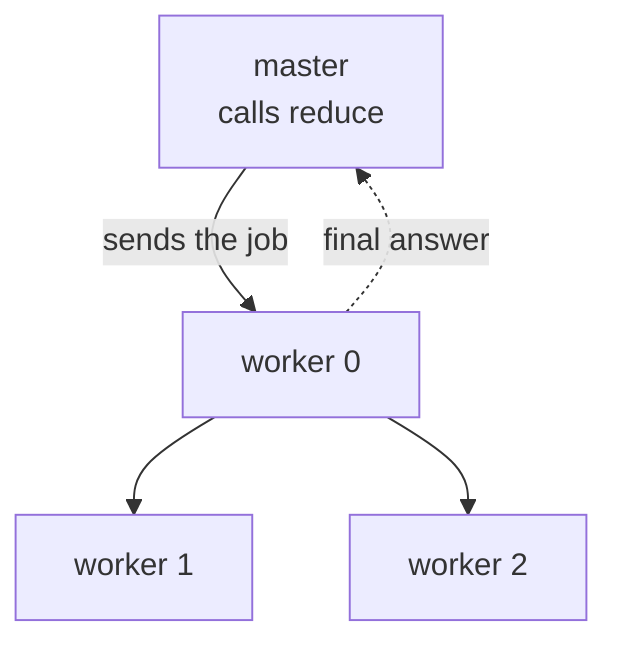
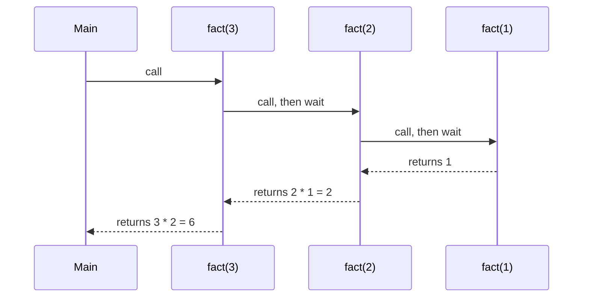
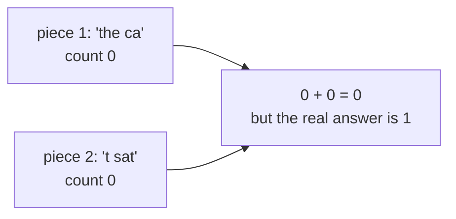

# Visuals

Pick the visual by the question the learner is asking.

| The learner asks | Draw |
|---|---|
| "What is X?" / "What holds what?" | Flowchart of the parts and how they connect |
| "What happens when...?" / "In what order?" | Sequence diagram |
| "How is A different from B?" | Comparison table |
| "What does the code do step by step?" | Trace table, plus a sequence diagram if processes or calls are involved |
| "Why doesn't the simple way work?" | Small diagram of the case that breaks, with the wrong result labelled |

## Mermaid rules that avoid broken diagrams

- Put every label in double quotes: `A["worker 1 holds 'the mo'"]`.
  Parentheses, commas, colons, and braces inside unquoted labels break the
  parser.
- Use ` ` for line breaks inside a label. Keep labels to two or three
  short lines.
- Inside a quoted label, use single quotes for strings, not double quotes.
- Keep it to about eight nodes. Split bigger ideas into several diagrams.
- `flowchart TB` for trees and hierarchies, `flowchart LR` for pipelines and
  "this, then this, then this".
- Label edges with the action: `M -->|"hands out Leaf"| W1`.
- Use `subgraph` to group things that live in the same place
  ("inside one worker" vs. "from outside").
- Use dotted edges `-.->` for return values or results going back.

## Flowchart: structure and data flow

## Sequence diagram: order in time

Good for recursion, message passing, and "who waits for whom".

## Comparison table

Name the two things in the header row and compare them on the questions the
learner cares about. Keep each cell to a short phrase.

| | Given version | Your version |
|---|---|---|
| Who does the work? | one process does everything | every worker does its own piece at once |
| What gets sent around? | all the data | small summaries |
| Parallel? | no | yes |

## Trace table

One row per step. Columns are the values that change. Add a "who is waiting"
column when there's concurrency or recursion.

| Step | Running | Value | Waiting |
|---|---|---|---|
| 1 | `fact(3)` | needs `fact(2)` | Main |
| 2 | `fact(2)` | needs `fact(1)` | Main, fact(3) |
| 3 | `fact(1)` | returns 1 | Main, fact(3), fact(2) |
| 4 | `fact(2)` | returns 2 | Main, fact(3) |
| 5 | `fact(3)` | returns 6 | Main |

## The case that breaks

When the naive approach fails, draw the exact input where it fails and show
the wrong answer next to the right one. This motivates the real solution
better than any explanation.

