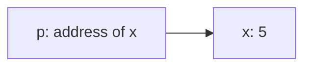
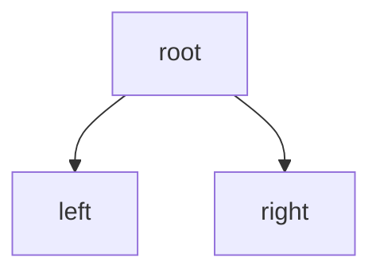
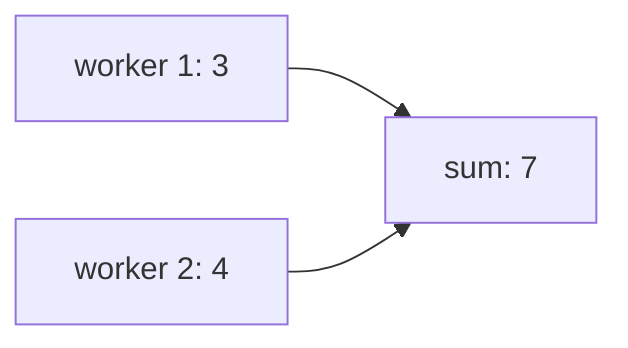
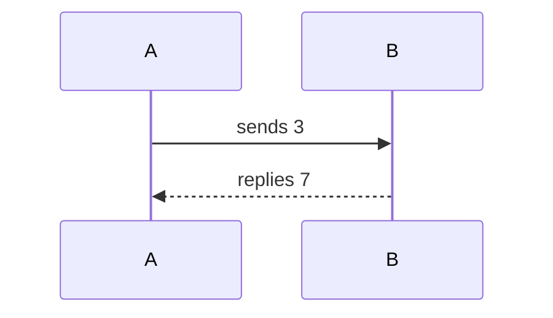

# Pictures

Only draw one if it's faster to read than the sentence it replaces.

## Keep it tiny

- About five boxes. Two or three words per box.
- Real Mermaid, not ASCII art made of `->` and `[]`.
- Put labels in double quotes so symbols don't break it: `P["p holds address"]`.
- Use ` ` for a second line. Use single quotes inside labels.
- `flowchart LR` for "this goes to that." `flowchart TB` for trees.

## Good uses

Something pointing at something:

A tree:

Data moving between places:

## Order in time

For "who runs first," a numbered list is usually easier than a diagram. Use a
sequence diagram only for messages between several processes, and keep it to a
few arrows.

